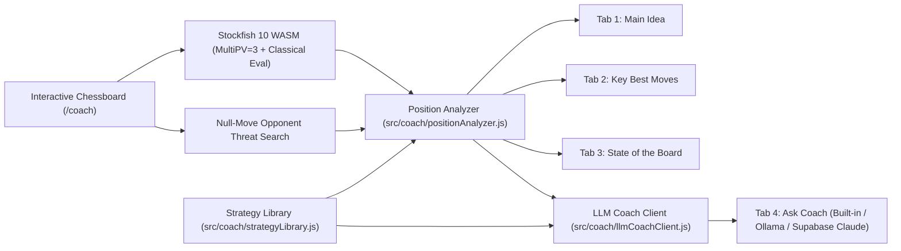

# Chess Academy Live Coach — Implementation and Progress Plan

Last updated: 2026-11-07
Starting commit: `7ba3379` (`main`)
Plan owner: Project maintainer + Antigravity / Codex

## Status snapshot

- Overall status: **Unified Live Engine & AI Coach (`/coach`) implemented, deployed to Supabase Edge Functions, and verified**
- Current release slice: **R7 — Unified Real-Time Coach, Fixed-Geometry Tabbed UI, Local Ollama & Supabase Cloud Proxy**
- Current task: **Complete — ready to commit/push or switch projects**
- Next validation gate: **Optional public GitHub Pages deploy check (`VITE_COACH_EDGE_FUNCTION=true`)**
- Blocking issues: **None**

This file is the durable handoff point for work that spans multiple sessions. Update the snapshot,
checkboxes, decision log, validation record, and session log before ending every implementation
session.

## Product outcome

Replace the standalone *My System* chapter tutorials and static Engine X-Ray drill with a unified,
calm, board-centric **Live Engine & AI Coach** (`/coach`):

1. **Always-Visible Central Chessboard (`30rem × 30rem` on desktop)** with permanent, fixed-height
   status, variation/control, and last-move feedback bars so the board never shifts or resizes.
2. **Real-Time Stockfish + Tactical/Positional Fact Extractor** (`src/coach/positionAnalyzer.js`)
   that runs `MultiPV=3` search alongside a **null-move opponent threat search**, loose/hanging
   piece detection, king-safety checks, opening/phase recognition, and Stockfish 10 classical
   evaluation breakdown.
3. **Fixed-Geometry 4-Tab Coaching Panel (`h-[39.25rem]`)** that organizes guidance into four calm,
   internally scrollable tabs without layout jitter or text clipping:
   - **Main Idea:** What to think about right now (opponent threats to neutralize, loose pieces,
     positional focus, and a recommended plan).
   - **Key Best Moves:** Top 3 Stockfish candidate moves translated into natural-language *why*
     explanations (`neutralizes threat`, `captures material`, `develops piece`, `castles to safety`,
     etc.) with interactive board arrows and PV preview.
   - **State of the Board:** Evaluation strip, classical evaluation factor grid, hanging/undefended
     piece radar, clickable move history, and FEN loader.
   - **Ask Coach:** Grounded conversational Q&A backed by `strategyLibrary.js` (Nimzowitsch's *My
     System*, Capablanca's *Chess Fundamentals*, opening principles, tactical motifs, and endgame
     technique) plus a pluggable LLM companion (**Built-in Offline Synthesizer**, **Local Ollama
     (`llama3.2`)**, **Supabase Edge Function (`coach-chat` → Claude Haiku 4.5)**, or direct
     BYOK for Anthropic/OpenAI/Gemini).



## Constraints and guardrails

- Preserve the React 18 / Vite / Tailwind architecture and static GitHub Pages compatibility.
- Keep the chessboard central and locked in geometry (`lg:grid-cols-[30rem_minmax(0,1fr)]`, fixed
  `h-[39.25rem]` right column, `grid-cols-[minmax(0,1fr)]` + `min-w-0` + `break-words` inside tabs)
  so streaming engine depths or long text never cause box resizing, layout bounce, or right-edge
  clipping.
- Stabilize live engine analysis (`stabilizedAnalysis` in `CoachPage.jsx`) so shallow depths (`1–5`)
  from a new search do not blank out or flicker existing coaching cards while Stockfish calculates.
- Never embed secret LLM API keys (`ANTHROPIC_API_KEY`, `OPENAI_API_KEY`, `GEMINI_API_KEY`) into
  public `VITE_*` GitHub Actions variables; use the deployed Supabase Edge Function
  (`supabase/functions/coach-chat/index.ts`) for public hosted coaching or `.env.local` / Local
  Ollama for local development.
- Do not ship, index, quote from, or import the local Quality Chess translation or its OCR.

## Architecture contracts

### Position coaching brief (`buildPositionBrief` in `src/coach/positionAnalyzer.js`)

```text
fen, turn, turnName, moveNumber
phase: { id: 'opening' | 'middlegame' | 'endgame', label }
opening: { eco, name, family, idea } | null
verdict: { label, tone, summary, totalScore }
whatToThinkAbout: string[]
recommendedPlan: string
candidateMoves[]:
  rank, san, uci, from, to
  score, mate, formattedScore
  pvSan[], pvUci[]
  why: string
  tags: string[]
facts:
  inCheck, checksAvailable[], capturesAvailable[]
  threatenedPieces[], hangingEnemyPieces[]
  undevelopedCount, castlingAvailable, centerControl
  imbalances: { strongestPositive, strongestNegative, ranked[] }
opponentThreat:
  san, uci, from, to, isCheck, capturedPiece, score, summary
```

### Move-played feedback (`evaluatePlayedMove` in `src/coach/positionAnalyzer.js`)

Compares the learner's played move against the pre-move `MultiPV` candidate list and post-move
evaluation drop (`delta`), returning a structured grade (`Optimal Move`, `Solid Choice`,
`Inaccuracy`, `Mistake`, or `Blunder — Tactical Alert`), concrete explanation, better move
recommendation, and refutation reply.

### Pluggable LLM Coach Client (`src/coach/llmCoachClient.js` & `supabase/functions/coach-chat/index.ts`)

Supports six provider modes:
- `builtin`: Deterministic synthesizer combining live Stockfish `MultiPV`, null-move threat facts,
  and retrieved `STRATEGY_CARDS`.
- `ollama`: Local offline LLM at `http://localhost:11434/api/chat` (default model `llama3.2`).
- `supabase`: Server-side Supabase Edge Function (`coach-chat`) on project `xhgthecnlswsvikgokfd`,
  using `ANTHROPIC_API_KEY` (`claude-haiku-5-5` with `thinking: { type: 'disabled' }`).
- `anthropic` / `openai` / `gemini`: Direct browser BYOK or `.env.local` fallback.

## Release map

### R0–R6 — Baseline, Engine Core, and Initial Study Lab Pilot (Completed 2026-07-30)

- [x] R0.1–R0.5 Audit repository, verify Stockfish 10 WASM `MultiPV` + classical `eval`, establish baseline.
- [x] R2.1–R2.8 Build pure UCI `info` and classical `eval` parsers, cancellable `MultiPV=3` worker pipeline, SAN conversion, and `useEngineAnalysis` React hook.
- [x] R4.1–R4.9 Build lexical strategy card retriever and copyright/OCR guardrails.
- [x] R6.1–R6.13 Pass unit/integration tests, zero-warning lint, content validation, and clean `dist/` check.

### R7 — Unified Live Engine & AI Coach, Fixed-Geometry UI, Local Ollama & Supabase Cloud Proxy (Completed 2026-11-07)

- [x] R7.1 Retire the standalone *My System* chapter tutorials (`/my-system`, `/my-system/coverage`, `/study/engine-xray`) and redirect legacy bookmarks cleanly to `/coach`.
- [x] R7.2 Build `src/coach/strategyLibrary.js` covering classical strategy (*My System*, *Chess Fundamentals*), opening principles, tactical motifs, and endgame technique.
- [x] R7.3 Build `src/coach/positionAnalyzer.js` with null-move threat detection, hanging-piece radar, natural-language `MultiPV` explanations, and `evaluatePlayedMove` grading.
- [x] R7.4 Build `src/coach/llmCoachClient.js` supporting Built-in Offline, Local Ollama (`llama3.2`), Supabase Edge Function (`coach-chat`), Anthropic, OpenAI, and Gemini.
- [x] R7.5 Install and configure local **Ollama** (`v0.40.15`, `llama3.2`, `OLLAMA_ORIGINS="*"`) for 100% free offline coaching.
- [x] R7.6 Restore paused Supabase project `xhgthecnlswsvikgokfd`, configure `ANTHROPIC_API_KEY` in Supabase Secrets, deploy `supabase/functions/coach-chat/index.ts` (`claude-haiku-5-5`), and verify live cloud responses end-to-end.
- [x] R7.7 Redesign `/coach` (`src/routes/CoachPage.jsx` & `src/components/NimzoCoach.jsx`) into a calm, board-centric layout with a permanent central board, depth-stabilized analysis, and a fixed-height (`h-[39.25rem]`) 4-tab panel (`Main Idea`, `Key Best Moves`, `State of the Board`, `Ask Coach`) free of box resizing or right-side text clipping.

## Validation record

| Date | Commit/worktree | Tests | Lint | Content | Build | Browser / Live API | Notes |
| --- | --- | --- | --- | --- | --- | --- | --- |
| 2026-07-30 | `7ba3379` baseline | 223 passed | Pass | 20 files / 50 terms | Pass | Pending | Clean baseline before feature work |
| 2026-07-30 | Visual-polish worktree | 293 passed | Pass | 20 files / 50 terms | Pass | Pass | Initial Study Lab pilot |
| 2026-11-07 | Unified `/coach` + Supabase + Ollama | 33 files / 302 passed | Pass (0 warnings) | 20 files / 50 terms | Pass (`dist/` clean) | Pass | Verified live `/coach` 4-tab fixed layout, local Ollama (`llama3.2`), and live Supabase `coach-chat` Edge Function (`claude-haiku-5-5`) |

## Decision log

- **2026-07-30 — Use Stockfish 10 as a teaching asset.** Its classical evaluation trace is more
  interpretable than a modern neural evaluator, even though it is weaker than current Stockfish.
- **2026-07-30 — Keep public content original.** The local Quality Chess OCR remains private and is
  never part of retrieval in the shipped app.
- **2026-11-07 — Replace static chapter tutorials with a unified Live Engine & AI Coach (`/coach`).**
  Interactive play (vs. Stockfish Levels 1–20 or Both Sides Sandbox) with real-time threat detection
  and optimal move explanations is far more engaging and practical than static book-chapter drills.
- **2026-11-07 — Use null-move search for concrete threat detection.** By flipping the side to move
  in the current FEN (clearing en-passant) and running a quick background Stockfish pass, the coach
  can warn the player what the opponent threatens to do *if given a free move* (e.g., `Qe6+` or
  `Qxb7`).
- **2026-11-07 — Lock container geometry and stabilize shallow engine depths.** Streaming engine
  updates and conditional banners previously caused layout jitter. Every panel in `/coach` now has a
  fixed height, internal scrolling, `grid-cols-[minmax(0,1fr)]` width constraints to prevent text
  clipping, and depth stabilization (`depth >= 6`) so cards gently swap text in place.
- **2026-11-07 — Use `claude-haiku-5-5` with `thinking: { type: 'disabled' }` in `coach-chat`.**
  Anthropic's newer Haiku 4.5 (`claude-haiku-5-5`) replaces retired 3.5 Haiku model IDs and returns
  fast, direct coaching prose when extended thinking is disabled.

## Session log

### 2026-07-30 — Initial Study Lab & Visual Hierarchy Pass

- Built the initial Engine X-Ray core, UCI/classical `eval` parsers, `useEngineAnalysis` hook, and
  original concept retrieval.
- Verified contrast thresholds and responsive layouts across mobile and desktop.

### 2026-11-07 — Unified Live Engine & AI Coach, Supabase Cloud Proxy & Fixed-Geometry UI

- Retired the standalone *My System* chapter tutorials and unified the study experience into
  `/coach` (`src/routes/CoachPage.jsx`).
- Built `src/coach/positionAnalyzer.js` (null-move opponent threat search, hanging-piece detection,
  `MultiPV=3` natural-language move explanations, and post-move grading) and
  `src/coach/strategyLibrary.js`.
- Built `src/coach/llmCoachClient.js` and `supabase/functions/coach-chat/index.ts`.
- Installed local **Ollama** (`v0.40.15`) on macOS, configured `OLLAMA_ORIGINS="*"`, and pulled
  `llama3.2:latest` for offline LLM coaching.
- Restored paused Supabase project `xhgthecnlswsvikgokfd`, uploaded `ANTHROPIC_API_KEY` to Supabase
  Secrets, deployed the `coach-chat` Edge Function using `claude-haiku-5-5`, and configured local
  `.env.local` (kept strictly git-ignored).
- Redesigned `/coach` into a calm, board-centric two-column layout (`lg:grid-cols-[30rem_minmax(0,1fr)]`)
  with a permanent `LastMoveBanner`, depth-stabilized analysis, and a fixed `h-[39.25rem]` 4-tab
  coaching card (`Main Idea`, `Key Best Moves`, `State of the Board`, `Ask Coach`).
- Fixed right-side text clipping inside CSS grid tab panels by adding explicit
  `grid-cols-[minmax(0,1fr)]`, `min-w-0`, and `break-words`.
- Verified all gates: 33 test files (302 tests) passing, zero-warning ESLint, content validation
  (20 lessons / 50 glossary terms), and clean production build.

## End-of-session handoff checklist

- [x] Update “Status snapshot.”
- [x] Check completed task IDs and leave incomplete work unchecked.
- [x] Add validation results with exact failures or limitations.
- [x] Add decisions that future sessions should not reopen without new evidence.
- [x] Add a dated session-log entry.
- [x] Leave the worktree in a known state and list any unrelated pre-existing changes.
- [x] Name the single best next action.

Known worktree state: all modifications belong to the unified Live Engine & AI Coach (`/coach`),
Supabase `coach-chat` Edge Function, and documentation updates. `.env.local` is git-ignored.
